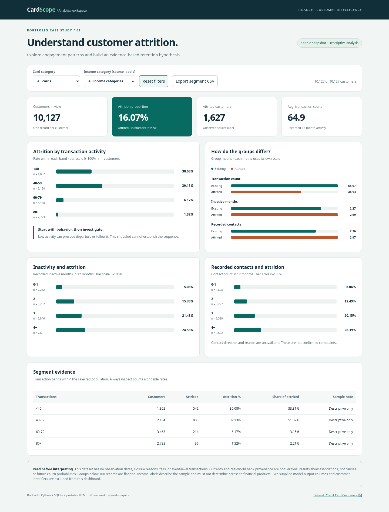
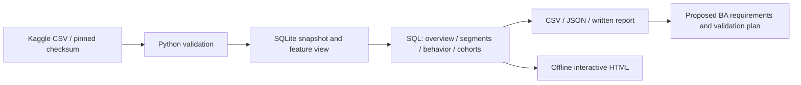

# CardScope — Credit Card Retention Analytics

A DA/BA portfolio case study: **understand how customer engagement is associated with observed credit-card attrition, then turn the evidence into a proposed investigation workflow.**

**10,127 customers · 1,627 labelled attrited · 16.07% snapshot attrition proportion**



## Explore the project

- **Interactive dashboard:** download the repository and open [`dashboard/index.html`](dashboard/index.html) in a modern browser. It works offline, includes card/income filters and aggregate CSV export. GitHub's file viewer shows HTML source; it does not run the dashboard.
- **Findings and recommendations:** [`reports/analysis.md`](reports/analysis.md).
- **BA requirements and user stories:** [`docs/business-analysis.md`](docs/business-analysis.md).
- **SQL analysis:** [`sql/`](sql/).
- **Guided notebook:** [`notebooks/01_exploration.ipynb`](notebooks/01_exploration.ipynb).
- **Hướng dẫn học và trình bày bằng tiếng Việt:** [`docs/learning-guide.vi.md`](docs/learning-guide.vi.md).

## Business questions

1. What proportion of the snapshot is labelled attrited?
2. How do transaction activity, inactivity, contact frequency and utilization differ across groups?
3. Which segments account for the greatest number of attrited customers, rather than just the highest percentage?
4. What additional evidence is needed before a bank could design a retention intervention?

This project does **not** claim to predict future churn, identify its causes, or demonstrate campaign uplift.

## Reproduce in under a minute

Python 3.11+ and SQLite (included in Python) are sufficient. No API keys or Python packages are required. The pinned CSV is included.

```bash
python -m src.pipeline
python -m unittest discover -s tests -v
```

Open `dashboard/index.html` directly. Alternatively, serve the repository locally:

```bash
python -m http.server 8000
# Open http://localhost:8000/dashboard/
```

The pipeline rebuilds `data/processed/retention.sqlite`, SQL result CSVs, a machine-readable KPI file, a quality report, a narrative report and the interactive dashboard. `data/processed/` is intentionally not committed.

To independently re-download the pinned Kaggle file:

```bash
python scripts/download_data.py
```

The downloader verifies the SHA-256 checksum and refuses unexpected replacements. If Kaggle requires login or changes availability, the committed source file still supports offline reproduction. Provenance and source licensing: [`data/README.md`](data/README.md).

## Selected findings

- Attrited customers average **44.9** recorded transactions, compared with **68.7** among existing customers.
- An illustrative low-activity/inactivity cohort contains **1,903** customers, **848** labelled attrited (**44.56%**). These are retrospective associations, not a validated targeting rule.
- Platinum has only **20** customers; its attrition percentage should not be ranked without considering the small denominator.

Recommendations focus on obtaining dated histories and closure reasons, validating feature timing, and designing a randomized pilot if operational evidence supports one. No fees, verified revenue, intervention outcomes, or customer-level transaction history are present.

## Architecture



The table grain matches the source: one row per customer snapshot. A star schema is not invented for a single flat snapshot with no fact-event history.

## Validation

- 16 automated Python checks cover reference counts, independent metric reconciliation, segment denominators, unknown categories, leakage exclusions, invalid inputs, band boundaries and small-sample flags.
- Browser checks reconcile every card/income filter combination with independent source calculations, cover reset, empty states, CSV export, mobile/tablet overflow and console errors.
- GitHub Actions is configured to run the Python checks, rebuild artifacts, and fail if the committed results differ. Remote CI status depends on the repository being pushed and Actions running.
- See [`docs/validation.md`](docs/validation.md) for executed checks and optional browser-test instructions.

## Repository map

```text
data/raw/              Pinned original Kaggle CSV
sql/                   Schema, feature view and analytical queries
src/                   Validated loader, SQL runner, report and dashboard generation
dashboard/             HTML template and self-contained generated dashboard
reports/               Reproducible metrics, CSV evidence, report and screenshot
docs/                  Data dictionary, BA proposal, validation and learning guide
notebooks/             Executed walkthrough of the same SQL pipeline
tests/                 Python validation and optional browser checks
scripts/               Checksum-verified downloader
.github/workflows/     Reproducibility check
```

## Scope and attribution

Dataset: [Credit Card Customers, Sakshi Goyal on Kaggle](https://www.kaggle.com/datasets/sakshigoyal7/credit-card-customers), listed as CC0. The uploader attributes it to Analyttica; the underlying bank and real-world provenance are unverified. Results must not be generalized to Vietnamese banking customers.

This portfolio was built with AI assistance. It is an educational case study, not bank employment or a completed production engagement. BA stakeholders and processes are explicit assumptions. Before presenting it as personal work, reproduce it and be ready to explain the implementation, findings and limits.

Code is MIT licensed; dataset licensing is documented separately in `data/README.md`.
