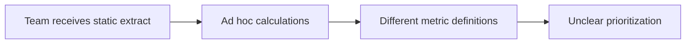
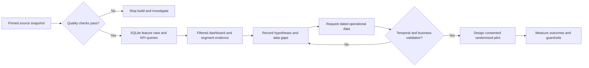

# Business analysis: retention investigation dashboard

**Status:** portfolio proposal. Stakeholders, workflows, requirements and acceptance criteria below are authored assumptions, not results of interviews with a real bank. The analytical dashboard is implemented; CRM contact execution and experiments are proposals only.

## Problem and scope

A hypothetical card-services team needs a consistent way to understand how customer engagement relates to observed attrition and decide what to investigate. Existing evidence is a static Kaggle snapshot, so the immediate product is an aggregate investigation dashboard, not a future-churn score or operational campaign engine.

**In scope:** data quality, SQL KPI definitions, segmentation, filtered evidence, aggregate CSV export, recommendations, an operational validation plan.

**Out of scope:** predicting default or attrition, fee optimization, real-time monitoring, contacting people, automated eligibility decisions, claiming retention lift, and production CRM integration.

## Assumed stakeholders

| Stakeholder | Need | Proposed responsibility |
|---|---|---|
| Card retention manager | Understand volume and segment patterns | Accountable for business prioritization |
| DA | Reproducible evidence, consistent metrics | Responsible for SQL and validation |
| BA | Clear scope, definitions and acceptance criteria | Responsible for requirements and traceability |
| Data engineering | Source grain and extraction contract | Consulted on operational data availability |
| CRM/service lead | Interpret contact history and feasible interventions | Consulted before campaign design |
| Privacy/compliance | Appropriate use of customer data | Consulted before any operational pilot |

## Assumed current and proposed processes

These diagrams are Mermaid flowcharts, **not BPMN** and not a verified bank process.

## Functional requirements and traceability

| ID | Priority | Requirement | Implementation / evidence |
|---|---|---|---|
| FR-01 | Must | Validate unique customer grain and domain constraints before reporting | src/pipeline.py; tests/test_pipeline.py |
| FR-02 | Must | Show customer count, attrited count, snapshot proportion and average transaction count | dashboard/index.html; sql/02_overview.sql |
| FR-03 | Must | Filter by card and income category; preserve Unknown | Dashboard filters; browser tests |
| FR-04 | Must | Show transaction, inactivity and contact-band proportions with customer counts | Dashboard charts; sql/03_segments.sql |
| FR-05 | Must | Compare existing and attrited customer means | Dashboard comparison; sql/04_behavior.sql |
| FR-06 | Must | Export current transaction-band aggregates with filter context | Export segment CSV button; browser tests |
| FR-07 | Must | State limitations and flag samples under 100 | Dashboard evidence table and limitations |
| FR-08 | Should | Document investigation hypotheses and next validation steps | reports/analysis.md; sql/05_investigation_cohort.sql |

## User stories and acceptance criteria

### US-01 / FR-02 — Understand the baseline

As a retention analyst, I want a consistent population baseline so I can interpret segment results.

- Given the unfiltered pinned dataset, when I open the dashboard, then I see 10,127 customers, 1,627 attrited customers and 16.07% attrition proportion.
- Given any filter, all four KPIs and every chart/table use the same selected population.
- The interface calls the metric a proportion, not a monthly churn rate.

### US-02 / FR-03, FR-04 — Explore segments

As an analyst, I want to filter a category and inspect behavioral segments so I can form investigation questions.

- Selecting Blue returns exactly the Blue population, verified against independent source counts.
- Selecting Unknown income retains those records and does not impute a salary.
- Reset restores the full population and all baseline metrics.
- Empty groups display zero counts and `—` for undefined proportions.

### US-03 / FR-05 — Compare engagement

As a service lead, I want existing/attrited group means so I can identify questions for service discovery.

- Means are computed independently within each status group.
- When a selected population has no members of a status, its mean displays `—`.
- The contact chart does not describe contacts as confirmed complaints or claim causality.

### US-04 / FR-06 — Export evidence

As an analyst, I want aggregate exports so I can review the same figures outside the dashboard.

- A CSV download includes active card/income filters, transaction bands, counts and unrounded proportions.
- Export has four segment rows even when some segments are empty.
- No customer identifiers are exported.

### US-05 / FR-01, FR-07 — Avoid misleading results

As a reviewer, I want invalid inputs rejected and small populations identified so I can assess evidence quality.

- Duplicate IDs, malformed input, missing mandatory columns, invalid labels and non-finite values fail the build.
- Exactly-zero denominators never produce Infinity or misleading 0% values.
- Groups below 100 customers are labelled small sample; proportions remain visible with counts.
- Two source Naive Bayes outputs are absent from the analytical table and dashboard payload.

## Nonfunctional requirements

- Run the core pipeline and tests with Python 3.11+ without third-party packages.
- Open the generated HTML offline with no CDN, telemetry or network dependency.
- Support 390px mobile, 820px tablet and desktop widths without whole-page horizontal overflow. Tables may scroll locally.
- Use visible focus indicators, labelled filters, text values beside chart bars, and semantic tables.
- Keep metric generation deterministic; CI compares rebuilt artifacts against committed evidence.

## Operational discovery questions

1. What exactly defines attrition, and when is each label assigned?
2. Do transaction and contact windows end before closure, after closure, or at extraction?
3. Are contacts inbound, outbound, complaint-related, or mixed?
4. What do inactivity and relationship count mean operationally?
5. Can closure reasons, fees, dated events, contact permissions and intervention outcomes be supplied?
6. What action can the retention team take, with what cost and guardrails?

## Proposed pilot (not performed)

With validated dated data, define eligibility among currently existing, contactable customers. Pre-register a behavioral rule, intervention and observation window. Randomize eligible customers into treatment/control, estimate sample size from a defined minimum detectable effect, and analyze all assigned customers.

Primary outcome: proportion active at day 90, with 'active' defined before launch. Compare treatment versus control in percentage points with confidence intervals. Guardrails: opt-outs, complaints and cost per assigned customer. Net benefit requires verified incremental contribution and campaign costs. None of these outcomes can be calculated from this snapshot.
