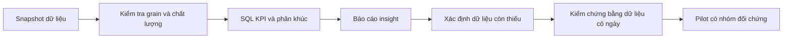

# Business analysis: retention investigation

Đây là tài liệu BA ngắn cho một case study dùng snapshot Kaggle. Stakeholder và quy trình là giả định để luyện phân tích, không phải quy trình của ngân hàng thật.

## Scope

**In scope:** kiểm tra chất lượng dữ liệu, định nghĩa KPI, phân khúc hành vi, báo cáo insight và đề xuất dữ liệu cần bổ sung.

**Out of scope:** dự đoán churn, tối ưu phí, liên hệ khách hàng, quyết định tự động và tuyên bố có retention uplift.

## Stakeholder giả định

| Stakeholder | Cần biết |
|---|---|
| Retention manager | Nhóm nào cần được điều tra |
| DA | KPI và bằng chứng có thể tái chạy |
| BA | Scope, yêu cầu và tiêu chí nghiệm thu |
| CRM/service lead | Lý do liên hệ và khả năng can thiệp |
| Privacy/compliance | Điều kiện để dùng dữ liệu vận hành |

## Quy trình đề xuất

## User stories và acceptance criteria

### US-01 — Baseline

Là retention analyst, tôi muốn có baseline thống nhất để diễn giải các phân khúc.

- Pipeline trả về 10.127 khách hàng, 1.627 attrited và tỷ lệ 16,07% trên dataset hiện tại.
- KPI gọi là snapshot proportion, không gọi là monthly churn rate.
- Số liệu có thể tái tạo từ `src/pipeline.py` và `sql/02_overview.sql`.

### US-02 — Phân khúc

Là DA, tôi muốn xem tỷ lệ đi cùng mẫu số để tránh ưu tiên sai một nhóm nhỏ.

- `reports/segments.csv` có customers, churned, churn rate và share of churn.
- Các nhóm `Unknown` được giữ nguyên, không tự suy đoán.
- Tổng customers và churned của từng dimension phải khớp toàn dataset.

### US-03 — Đề xuất hành động

Là BA, tôi muốn biến insight thành câu hỏi kiểm chứng trước khi yêu cầu can thiệp.

- Báo cáo nêu rõ insight, giới hạn và dữ liệu cần bổ sung.
- Không gọi cohort thăm dò là danh sách khách hàng có nguy cơ.
- Pilot tương lai phải định nghĩa KPI, nhóm đối chứng, chi phí và guardrails trước khi chạy.

## Dữ liệu cần bổ sung

Ngày giao dịch, ngày đóng thẻ, lý do đóng, phí, hướng và kết quả liên hệ, quyền tiếp thị và kết quả can thiệp. Không có các trường này thì không thể kết luận nguyên nhân hoặc hiệu quả giữ chân.
