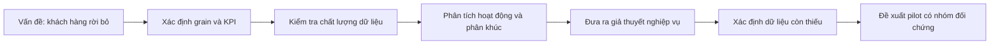

# Câu chuyện nghiệp vụ để trình bày khi apply

## Bối cảnh

Một nhóm chăm sóc khách hàng thẻ tín dụng nhận thấy có một bộ phận khách hàng được ghi nhận là đã rời bỏ dịch vụ. Nhóm cần biết những dấu hiệu hành vi nào đáng để điều tra trước khi thiết kế một chương trình giữ chân.

Đây là case study portfolio dùng một snapshot công khai trên Kaggle. Không nên giới thiệu nó là dữ liệu của một ngân hàng Việt Nam hay là dự án triển khai thật.

## Câu hỏi kinh doanh

1. Tỷ lệ khách hàng được gắn nhãn `Attrited Customer` là bao nhiêu?
2. Nhóm nào đóng góp nhiều khách hàng rời bỏ nhất khi xét cả tỷ lệ và quy mô?
3. Hành vi giao dịch, số tháng không hoạt động và số lần liên hệ khác nhau như thế nào giữa hai nhóm?
4. Cần thêm dữ liệu nào trước khi quyết định gọi cho khách hàng hoặc giảm phí?

## Cách tiếp cận

Điểm chính của dự án là chuyển từ một câu hỏi kinh doanh sang bằng chứng có mẫu số rõ ràng, rồi chuyển kết quả thành yêu cầu cần xác minh. Dashboard chỉ là cách trình bày phần kết quả đó.

## Kết quả hiện có

- Snapshot có 10.127 khách hàng; 1.627 được gắn nhãn đã rời bỏ, tương đương 16,07% trong snapshot.
- Nhóm 40–59 giao dịch có 2.134 khách hàng, tỷ lệ gắn nhãn rời bỏ 39,13%, đóng góp 51,32% số khách hàng rời bỏ.
- Nhóm đã rời bỏ có trung bình 44,9 giao dịch, so với 68,7 ở nhóm còn lại.
- Cohort thăm dò `<60 giao dịch và >=3 tháng không hoạt động` có 1.903 khách hàng, trong đó 848 được gắn nhãn rời bỏ.

Các số trên là mô tả và liên hệ trong một snapshot. Chưa thể nói giao dịch ít là nguyên nhân, vì không có ngày sự kiện để biết hành vi xảy ra trước hay sau việc rời bỏ.

## Quyết định chưa được phép đưa ra

Không được kết luận giảm phí sẽ giữ chân khách hàng, không được gọi cohort này là danh sách khách hàng có nguy cơ, và không được tuyên bố đã giảm churn hoặc tăng doanh thu. Dataset không có phí, lý do đóng thẻ, ngày đóng thẻ, dữ liệu giao dịch từng lần hay kết quả can thiệp.

## Đề xuất BA tiếp theo

Yêu cầu dữ liệu vận hành có ngày: lịch sử giao dịch, ngày đóng thẻ, lý do đóng, phí, hướng và kết quả liên hệ, trạng thái cho phép tiếp thị. Sau khi xác nhận các biến xảy ra trước kết quả, thiết kế pilot ngẫu nhiên:

- KPI chính: tỷ lệ còn hoạt động sau 90 ngày.
- Đối chứng: không nhận can thiệp trong cùng thời gian.
- Guardrails: khiếu nại, opt-out và chi phí trên mỗi khách hàng.
- Phân tích: intention-to-treat, chênh lệch điểm phần trăm và khoảng tin cậy.

## Cách nói trong phỏng vấn

> Tôi xây một case study DA/BA cho bài toán giữ chân khách hàng thẻ tín dụng. Tôi bắt đầu từ định nghĩa grain và KPI, kiểm tra chất lượng dữ liệu bằng Python/SQLite, dùng SQL để phân khúc theo hành vi, rồi viết tài liệu BA gồm scope, user story và acceptance criteria. Vì dữ liệu chỉ là snapshot, tôi trình bày kết quả như association và nêu dữ liệu cần bổ sung trước khi triển khai một pilot.

Nếu được hỏi “tại sao không dùng phí để kết luận?”, câu trả lời là: dữ liệu không có phí và không có thời gian, nên đó là một giả thuyết cần yêu cầu thêm dữ liệu chứ không phải insight đã được chứng minh.
